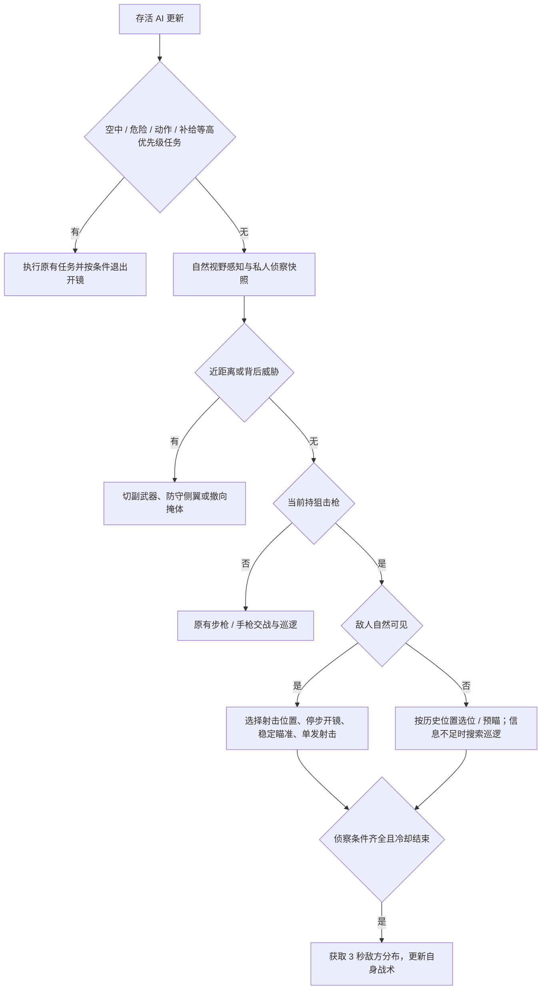

# FPS 狙击、侦察与随机配装

2026-11-08 · OpenAI Codex（基于 GPT-6）。适用于当前桌面 Three.js 项目。入口仍为 `index.html`，本地服务器和双击离线启动共用相同代码。

## 代码职责

| 文件 | 责任 |
| --- | --- |
| `js/equipment.js` | 角色阵营 / 开放状态、推荐配装、`roster()`、头部装备互斥、侦察资格与时长 |
| `js/fps-ai.js` | 感知、行为优先级、武器切换、狙击选位、私人侦察记忆 |
| `js/game.js` | 创建角色与装备、伤害和真实射线、AI 实体生命周期、对局时钟、动作同步 |
| `js/characters.js` | 各角色动作、Socket、第一人称中立姿势校准 |
| `js/sniper-cycle.js` | 共享 1.15 秒拉栓时轴、枪栓 / 弹壳姿势；不修改弹药 |
| `js/weapon-rules.js` | 弹药兼容、拾取评估与 AI 狙击名额检查 |
| `js/recon-fx.js` | 人类玩家的敌方穿墙描边，不修改战斗碰撞 |
| `css/fps.css` | 狙击持有 / 开镜状态下的普通准星显隐 |

## AI 选角与出场配装

每场开始调用 `FishEquipment.roster(teamSize, myTeam, playerKit)`，只从 `characters` 中同阵营且 `available` 的角色等概率抽取。当前红方可选 deepseek / 伪·Claude，蓝方可选真·Claude。尚未提供模型的预告角色不会进对局。

每队 AI 槽位先均匀打乱，再选 `floor(AI人数 / 2) + 1` 个槽位采用初始角色推荐防具，随后应用下述红方偏好和头盔人数平衡。防具偏好和狙击名额独立：2026-11-08 收紧狙击比例，取消“过半真·Claude 必须带狙击”的旧规则。

| 角色 | 推荐主武器 | 推荐头部装备 |
| --- | --- | --- |
| deepseek娘 | 突击步枪 | 铁饭碗：前三次子弹爆头免疫 |
| 伪·Claude娘 | 突击步枪 | 铁饭碗：前三次子弹爆头免疫 |
| 真·Claude娘 | 狙击名额内优先狙击，其余突击步枪 | 战术护目镜：配合狙击开镜启用侦察 |

`FishEquipment.botSniperLimit(teamSize)` 为 `max(1, floor(teamSize / 6))`。双方使用相同 AI 名额，**不计入人类玩家选枪**：

| 对局规模 | 每队 AI 狙击手 |
| --- | --- |
| 6v6 / 8v8 | 1 |
| 12v12 / 16v16 | 2 |

全部 AI 先使用突击步枪，再从打乱的槽位分配狙击角色，优先持护目镜的真·Claude，其次非偏好组，保证当前红方过半 AI 的突击步枪 + 铁饭碗组合。其余主武器保持突击步枪，副武器均随机。

红方偏好组继续固定铁饭碗；其余红方 AI 从旧版“护目镜 / 空头各 50%”改为 **铁饭碗 70% / 护目镜 10% / 不佩戴 20%**。现有 deepseek / 伪·Claude 因此更常获得三次子弹爆头免疫，护目镜只是低概率选择。7,200 组名单中的红方统计约为 87.1% 铁饭碗、4.3% 护目镜；这些是抽样结果，不是每场固定人数。

两队铁饭碗数量差仍不超过 2 人，包含玩家。红方增加头盔后，先从蓝方非狙击手中随机补配头盔；不更改蓝方狙击手的护目镜或玩家装备。若 12 / 16 人配置中蓝方所有非狙击手均已有头盔、仍有差额，则只移除红方非偏好组的额外头盔，保留基础偏好组和玩家选择。因此蓝方最终护目镜人数不再保证过半，狙击手的侦察装备仍有保障。只在部署名单生成时平衡，战斗中不会补回破损头盔。

配装存在 `PVP.botLoadouts`，在同一场比赛复活、换回合时保留。玩家仓库配置只用于人类玩家。AI 仍可拾取补弹 / 换枪，但 `pickupDecision()` 将固定的 `spawnPrimary === 'sniper'` 资格传入 `FishWeapons.decide()`；无狙击名额的 AI 即使主武器槽空着，也不能捡狙击枪或通过“偏爱”绕过限制。原狙击手可补充狙击弹药或重新拾枪。新比赛才重新分配名额，死亡不把名额临时转给其他 AI。

FPS 预载三名已开放角色，动作与模型在浏览器缓存中共享，没有新增模型副本。无尽 / 剧情保留按需加载。

## 行为优先级与狙击状态

继续使用现有按优先级判断的行为树，没有引入另一套行为树库。空中物理、已发现手雷的躲避、投雷 / 近战动作、补给、换弹等高优先级分支先处理，再进入侦察防守、狙击或普通交战分支。

- 普通视野为总计 110°；狙击腰射观察 72 米，开镜观察 90 米但视野缩窄为总计 24°。墙体仍参与自然视线判定。
- `sniper-aim` 停步开镜，开镜建立需 0.22 秒，再满足反应时间和稳定瞄准。每次开火重新检查视线、友军挡枪、弹药、落地状态。
- `sniper-fire` 是单发，开火立即退镜。`sniper-cycle` 持续 1.15 秒，同步退壳 / 闭锁 / 手部动作；即使目标进入遮挡也先完成动作。期间不开镜、不再次射击、不补弹匣；前 0.55 秒可短距离侧移。完成后重新建立瞄准，保留最短 1.35 秒射击间隔，实际间隔还受稳定瞄准与视线影响。
- 对手距自己不足 11 米时优先切副武器，威胁退至 17 米之外并经过防抖时间才恢复狙击。切副武器 0.5 秒 / 切回狙击 0.8 秒期间禁射。
- 不适合射击距离、低血量需要掩体或侦察发现多人近距夹击时，寻找新的可达位置。候选位置检查地面高度、导航、队友占用、射线、距离和侧翼威胁，仅对排名靠前位置求路径，避免每帧全图搜索。
- 侦察显示背后近敌时，优先防守该方向；有正面远敌也不会一直只盯正面。隐藏目标只能促使预瞄 / 防守 / 转移，不能直接触发穿墙射击。
- 狙击枪的基础持握、移动与整匣换弹复用该角色自己的 Rifle 动作；拉栓是独立程序骨骼层和活动枪栓，没有导入重复动作文件。空弹匣的 AI 等拉栓完成后才开始整匣换弹。

## 玩家射后动作与回镜

`game.js` 的 `scopeInputHeld` 记录右键按住状态，`scopeHeld` 记录是否允许进入瞄准。射击先按射击瞬间的开镜精度生成子弹，再立刻退镜，保留右键状态。`sniperCycle.time` 从 0 推进到共享的 1.15 秒终点：抬栓 → 后拉退壳（0.42 秒）→ 推栓闭锁（0.90 秒）→ 手回握把（1.15 秒）。**只有整个动作完成后**才检查右键并启动回镜；动作中重新按右键同样需要等待，松开则取消回镜意图。

拉栓期间禁射、不能开镜，弹匣与备弹不变，最后一发也退壳。R 请求排队到拉栓结束后，才执行 2.8 秒补充弹匣；没有备弹而不能换弹时，仍按右键可正常回镜。切枪、丢枪、死亡、复活清理动作与回镜意图；暂停冻结动作并清理按键残留。对战与无尽玩家共用此流程。

退出开镜也会结束护目镜当前侦察显示，60 秒冷却保留；自动回镜不会自动重开技能。

## 侦察的信息边界

资格统一调用 `FishEquipment.canRecon()`：存活、对战、真·Claude、完好护目镜、当前狙击枪、已经开镜。AI 另外排除换弹、切枪、跳跃、投雷和近战动作。头部装备始终互斥。

是否发动只基于已看到 / 最近记得的敌人、近期受击，以及离开出生点后的巡逻探查时机；**发动之前不能用隐藏敌方位置决定是否发动**。

有效期 3 秒，冷却从发动开始计 60 秒，与玩家使用同一 `PVP.clock`；暂停时冻结，正常回合间隔继续计时。AI 每 0.12 秒采样一次敌方存活实体，将坐标、地面位置与采样时间写入自己的 `recon.contacts`，不写入全队无线电或小地图情报。

效果结束或资格失效即停止采样。已有记录最多使用到采样后 6 秒，仅作为历史位置；近身防守 / 多人压力使用更短的 4 秒窗口。敌人之后移动不会同步更新旧快照。AI 可据此选位和预瞄，但实际射击必须重新自然目视并通过墙体和友军射线检查。

`e.recon.readyAt` 是实体上的跨生命冷却；`brain.recon` 引用它。死亡和换回合清空激活状态 / 联系人，`reset()` 不替换冷却截止时间。复活重新配发装备耐久，不能刷新侦察冷却。只有新一场比赛重置。

## 第一人称校准

旧固定根偏移造成真·Claude 的枪械比 deepseek 高约 19 厘米。现在各角色用自己的 `RifleIdle` 第 0 帧测量 Socket 握点，缓存整个双臂根节点补偿，手和枪一起移动；狙击另向下 5 厘米、向前 12 厘米。实机三名角色枪械原点约为相机局部 `(0.25, -0.22, -0.71)`，世界模型比例和胶囊体不变。

持狙击枪时隐藏普通准星，切到其他武器恢复；右键狙击镜的刻度保留。调试脚本 `tools/inspect-first-person.cjs` 可输出三名角色的原点与原生渲染图，完整说明见 `assets/characters/runtime/INTEGRATION.md`。

## 验证与继续开发

- `tests/fps-sniper-recon-test.cjs`：7,200 组配装（四种人数、两个玩家阵营、三种头部选择、两种玩家主武器，各 150 组）；AI 拉栓 / 空弹匣顺序、资格、射击间隔、近身切枪、遮挡、侦察记忆与冷却。
- `tests/browser-sniper-cycle-test.cjs`：实际鼠标输入、动作完成前 / 后的回镜、R 排队、空弹匣、暂停 / 切枪 / 死亡、三角色第一 / 第三人称手部与枪械稳定性。
- `tests/browser-sniper-ai-test.cjs`：实际加载、三角色第一人称、普通准星 / 镜内刻度、模型装备、实图 AI 子树、死亡 / 复活冷却、护目镜破损。支持 `FISH_TEST_URL` 选择 HTTP / `file://`。
- 继续保留 `fps-ai-test.cjs`、`fps-retreat-test.cjs`、`fps-jump-test.cjs`、`grenade-awareness-test.cjs`、原狙击浏览器和核心冒烟测试。本轮桌面验证目录为 `tests/sniper-balance-results/`。

后续新增可选角色时，将 `roster()` 的角色推荐分支提取成配置表，并重新验证各队装备人数平衡；不能只把 `available` 改成 true 而不加载模型。地图可补充经关卡作者确认的狙击点 / 转移出口，作为现有可达候选的额外输入，减少狙击手在不理想掩体边缘等待。新增专用狙击动画时保留现有射速、换枪禁射与侦察资格，不让动画事件额外生成第二次开火。
