# 蓝色肥鱼大作战 🐟🔫

> **2026-10-21 · Codex 场景与战斗优化补丁**：新增沙海哨站场景细节、程序化材质、原画浅弧模型；追加武器模型、枪焰弹道与爆炸特效，修正 Boss 瞄准和三管炮出膛位置，并完善资源回收。玩法版本沿用 V0.5.2，具体改动、验证结果和后续建议见 [CODEX_优化与开发建议.md](CODEX_优化与开发建议.md)。

> **V0.5.3**（美术补丁）· 基于 Three.js 的 3D 第一人称射击游戏
> （v0.2 系列：连杀评级、局内强化与敌人成长、护甲道具、技能面板、五场景 BGM 体系、开发者模式全套；
>  v0.3.0：摄像机打击反馈系统 + 近战肥鱼手持小剑；
>  v0.4.0：波次与阶段系统 + 四种新敌人 + 自爆红屏警告 + 连杀评级增益；
>  v0.5.0：三武器系统（双枪 + 匕首）+ 弹药与扩容弹夹重构 + 5 种 Boss 变体 + 环境主题
>  + 成就系统 + 设置面板 + 真实音效 + 全面光影与 UI 重做；
>  v0.5.1 修正：三选一保证核心牌 + 弹夹掉落全有效 + 匕首范围 2.6 米 + 弹药箱重做
>  + 小怪成长放缓 + 5 种环境挂玩法规则 + 三武器引导 + 第 14 项成就；
>  v0.5.2 修正：弹药箱出现概率重做（满弹 0% / 剩余≥25% 最多 30% / 剩余<25% 必出）
>  + 开发者模式 Boss 召唤快捷键（小键盘 0 / 5~8，同时切换对应环境主题，方便录制演示）；
>  **v0.5.3 美术补丁：Codex 两轮场景与战斗优化（沙海哨站场景 / 程序化武器 / 枪焰弹道爆炸特效 /
>  Boss 瞄准与三管炮出膛修正 / 资源回收）+ 三种敌人新形象贴图 + Boss 武器位置调整 + 右键捕获阶段加固**）
> 零构建、零依赖、单页面启动、离线可玩 —— 双击 `index.html` 开打！


## 📖 简介

一群「蓝色大肥鱼」占领了沙漠城 —— 它们会巡逻、发现你后疯狂逼近：
有的**端着枪**、有的**抱着核弹**、有的**举着能量盾**、还有的**会治疗同伴**或**死了都要分裂**。
消灭它们、猎杀五类巨型 Boss、在越来越恶劣的环境里活下去。

### 🔫 三把武器，各有取舍（V0.5.0 核心）

| 键位 | 武器 | 开局弹夹 | 特点 |
| --- | --- | --- | --- |
| **1** | 手枪 | **7**（可扩容至 15）| **点射**：按一下打一发，单发伤害 1.0 倍 |
| **2** | 突击步枪 | **25**（可扩容至 120）| **全自动**：按住连发，0.72 倍伤害 + 轻微散布 |
| **3** | 匕首 | — | **近战 2.6 米**：轻击 2 / 右键重击 4（恒 2 倍），弹尽粮绝时的「铤而走险」|

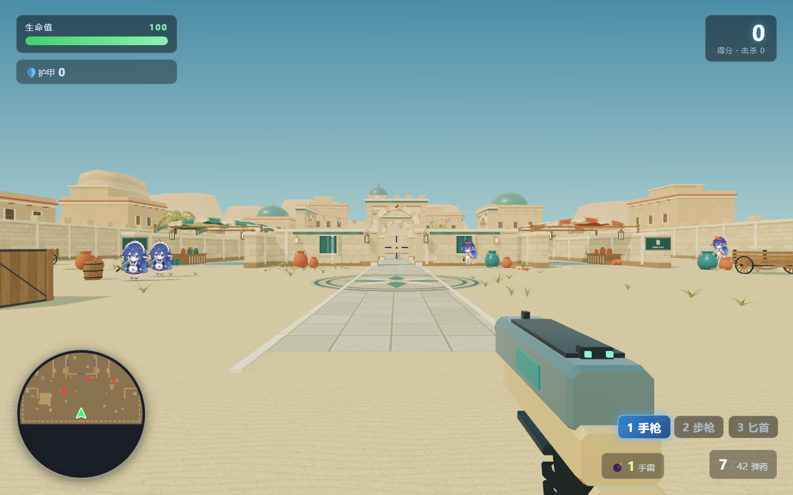

**弹药不再充裕**：开局手枪只有 7 发 + 42 备弹、步枪 25 发 + 100 备弹，你必须捡弹药箱。
**弹药箱拾取后两把枪各补「一个弹夹容量」的备弹**（各自受上限约束）；
弹药箱的出现概率按「两把枪剩余备弹 / 备弹上限总和」动态计算：
- **满备弹 → 0%**（完全不刷）
- **剩余 ≥ 25% → 最多 30%**（越紧张越接近 30%）
- **剩余 < 25% → 100% 必出**（真正弹尽粮绝时一定给补给）
**扩容弹夹靠击杀特殊敌人掉落**（**不叠加**，只有更高级别才会替换，同级或更低不会生效）：
- 手枪：标准 7 → 小 10 → 中 12 → **大 15**
- 步枪：标准 25 → 小 35 → 中 48 → **大 60** → **弹鼓 120**

**大扩容弹夹会让移速下降 5%，弹鼓更是下降 10%** —— 火力与机动，你只能选一个。
备弹上限也随弹夹变化：手枪 = 弹夹 × 8、步枪 = 弹夹 × 6。
**击败 Boss 会把两把枪的弹夹补满**，并各奖励「一个弹夹容量」的备弹。

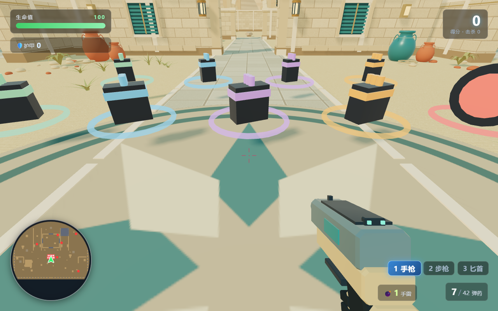

### 🌍 五种环境，每 10 波一变
**晴日沙漠 → 黄昏 → 沙尘暴 → 血月 → 深夜**。天空、雾气与光线同步变化，
切换时屏幕中央会弹出**半屏大字**，让你立刻意识到「战场变了」。

**而且每种环境都有独立的玩法修饰**（不只是换皮）：

| 环境 | 玩法修饰 |
| --- | --- |
| 晴日沙漠 | 基准环境 |
| 黄昏 | 补给刷新间隔 **-20%** |
| 沙尘暴 | 视野骤降，但**敌人索敌距离同步 -30%**（公平交换）|
| 血月 | **敌我伤害双双 +10%**（高风险高回报）|
| 深夜 | 视野最差，但**手雷伤害 +30%、爆炸半径 +1 米** |

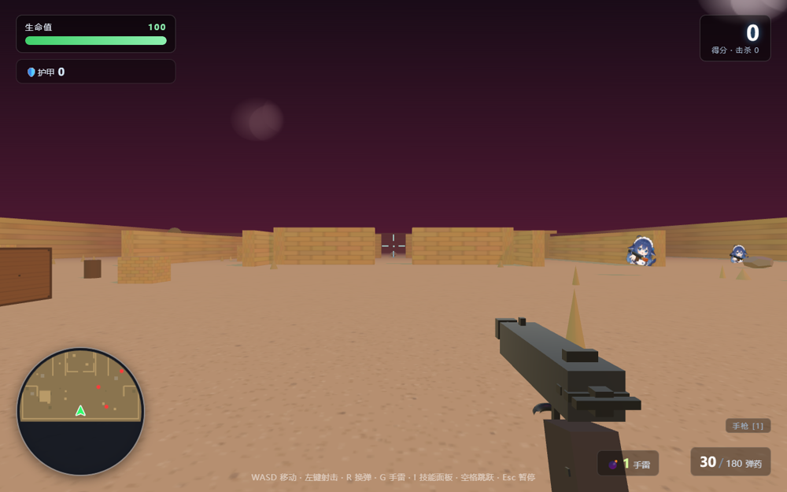
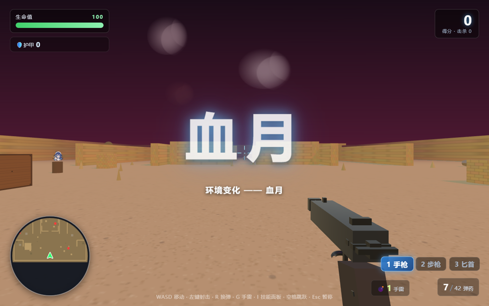

### 👑 五类 Boss，打法完全不同
| 阶段 | Boss | 战斗方式 |
| --- | --- | --- |
| 1 | **超级蓝色大肥鱼** | 半跟踪火箭弹（炮弹还能被你的子弹打爆！）|
| 2 | **狂暴冲锋鱼** | 蓄力后以 15 m/s 高速冲撞 |
| 3 | **召唤祭司鱼** | 不断召唤鱼群，并主动后撤保命 |
| 4 | **重炮台鱼** | 三连扇形炮幕，几乎不移动 |
| 5 | **分裂母鱼** | 血量过半暴走，分裂出强化小怪 |

每次登场都有**三层地面扩散光圈 + 上升光柱**的出场演出。

### 🏆 成长与记录
- **3 选 1 技能强化**：核心五项（子弹威力 / 弹药回收 / 吸血再生 / 手雷补给 / 疾风步伐）各 **8 级**，
  外加五项扩展（致命打击 / 穿甲弹 / 高爆手雷 / 护甲强化 / 杀戮汲取）
- **每击败一只 Boss 可以强化两次**；核心五项满级后再击败一只 Boss 即**通关无尽模式**
  （通关周期约 100 波 / 60-75 分钟）
- **14 项成就** + **本地最佳记录**（最高分 / 最久存活 / 最高连杀 / 最远波次 / Boss 击破数）
- **连杀评级有实际收益**（D→C→B→A→S→SS→SSS）：B 级提速、A/S 提伤、**SSS 附带击杀吸血**

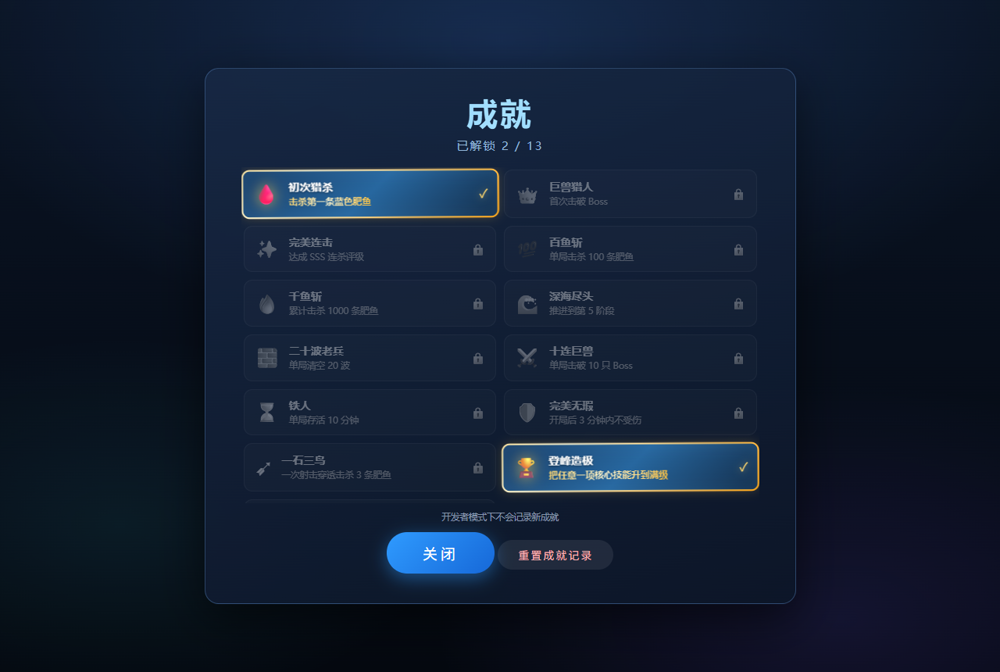

### ⚙️ 完整设置面板
四路音量分离（主曲 / Boss 曲 / 菜单曲 / 音效）、鼠标灵敏度、粒子与阴影开关、
**色盲友好配色** —— 全部实时生效并自动保存。

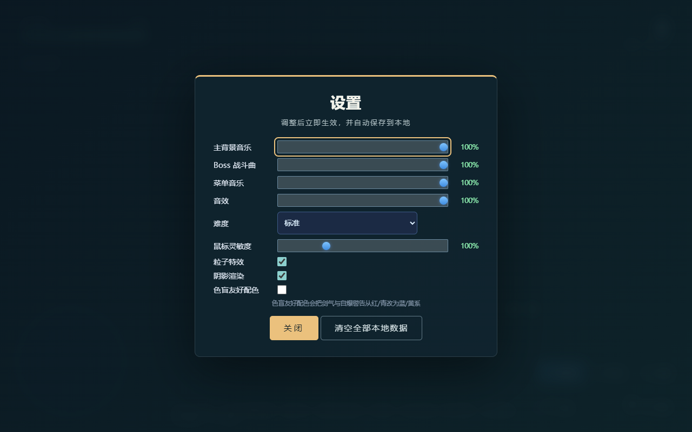

## 🎮 启动方式

| 方式 | 操作 |
| --- | --- |
| **直接玩** | 双击 `index.html`（推荐 Chrome / Edge，无需服务器、断网可玩）<br>流程：开始游戏 → **关卡选择**（闯关模式敬请期待 / 无尽模式—沙漠城）→ 进入沙漠城 |
| **本地服务器** | 双击 `启动游戏.bat`（或 `node server.js` 后访问 `http://127.0.0.1:8123/`） |

## ⌨️ 操作

| 按键 | 功能 |
| --- | --- |
| W A S D | 移动（支持方向键） |
| **1 / 2 / 3** | **切换武器**：手枪（点射）/ 突击步枪（全自动）/ 匕首（近战）|
| 鼠标左键 | 射击（步枪可按住连发、手枪为点射）／ 匕首**轻击** |
| **鼠标右键** | 匕首**重击**（伤害恒为轻击的 2 倍；右键菜单已在游戏内完全屏蔽）|
| R | 换弹（手枪 7 发 / 步枪 25 发起，1.5~2 秒） |
| G | 手雷（落地即爆，半径 4 米） |
| I | 技能等级面板（查看本局限时强化等级，打开时游戏暂停；再按 I 或 Esc 关闭） |
| 空格 | 跳跃（可跳上箱子/石头/高台） |
| Esc | 暂停 |
| 💡 秘技 | 5 秒内按 **WWSSAADDBABA** 进入/退出**开发者模式**（生命/上限 99999、每 5 秒回 100 血，
  左侧显示伤害/击杀 Debug 日志，"上上下下左左右右BABA"梗）
| 💀 自毁 | **开发者模式下** 4 秒内按 **KILL**：退出开发者模式并自杀（结算"你选择了自我了断…"） |

## 👾 敌人图鉴

### 1. 普通近战鱼
巡逻 → 发现玩家 → **1.5 倍速**追击咬人（15~25 随机伤害），中枪即消失（每条 +10 分）。
> ⚠️ **成长**：每击杀 **2 只** Boss 小怪血量 +1（≤10）；血量到 10 后攻击力每 Boss +1（近战 ≤50）。
> 攻击判定为**三维距离**——站上箱子/顶棚/高台，近战怪咬不到你！

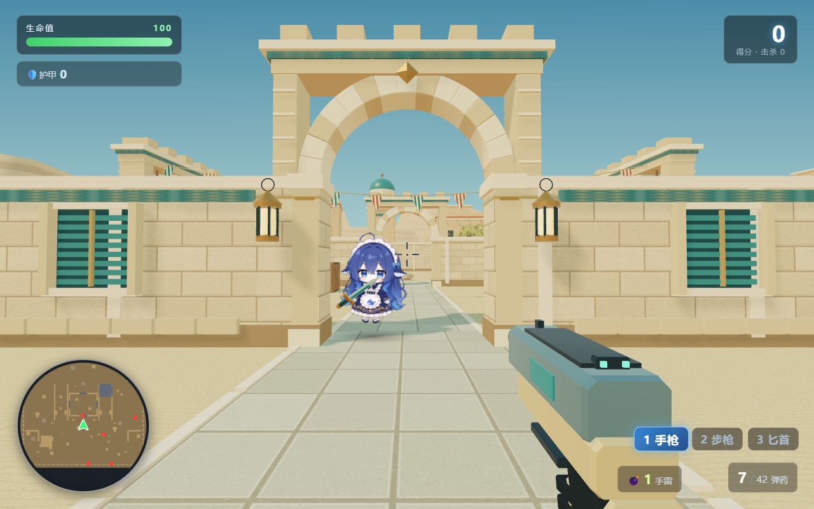

### 2. 远程射手鱼（50% 概率生成）
外观与普通鱼相同，**但手里端着金橙色的枪**——发现玩家后向前推进 1 米站桩开火，
**每秒 2 发子弹**（每发 7~12 伤害）。贴脸绕后是它的软肋。
> ⚠️ **成长**：攻击成长时每颗子弹 +1（≤30 伤害）。

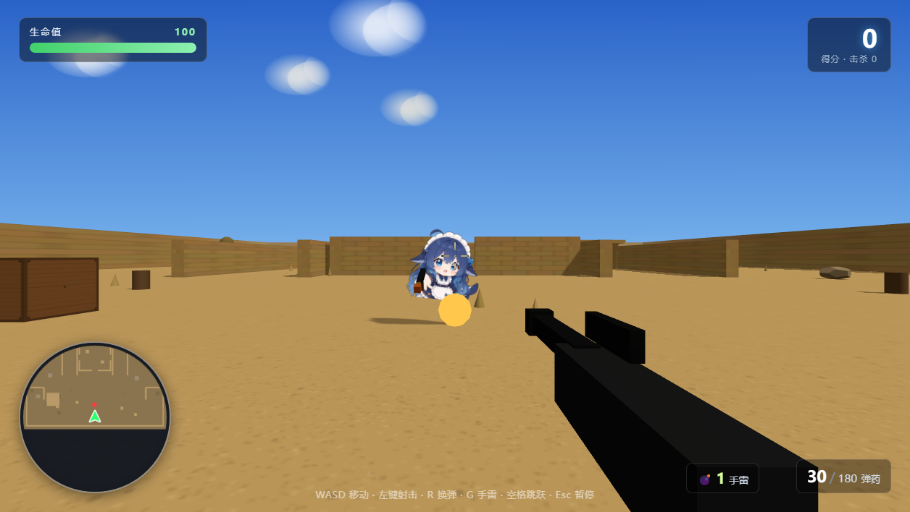

### 3. Boss「超级蓝色大肥鱼」（阶段 1）

> 📌 **出现规则**：**每清理 5 波必定出现一只**（Boss 存活期间波次暂停），场上唯一；
> 从第 2 阶段起，Boss 会换成另外四种类型（见下方 9~13 号条目）

- **3 倍体型**、手里端着**火箭筒**；血量随击杀数成长（15 起，每只 +5，上限 100）
- 发射**半跟踪炮弹**（命中扣 25 起，每只 Boss +2、上限 60）；
  炮弹落地或撞墙会爆炸（半径 2 米、仅伤玩家、威力 -10%）
- **炮弹可以被你的子弹打爆** —— 打中 3 发使炮弹空爆，**空爆对敌我通用**！
- **击败奖励**：生命回满 + **两把枪的弹夹全部补满** + **各获得一个弹夹容量的备弹**
  + 随机 1~3 颗手雷（另 +50 分）

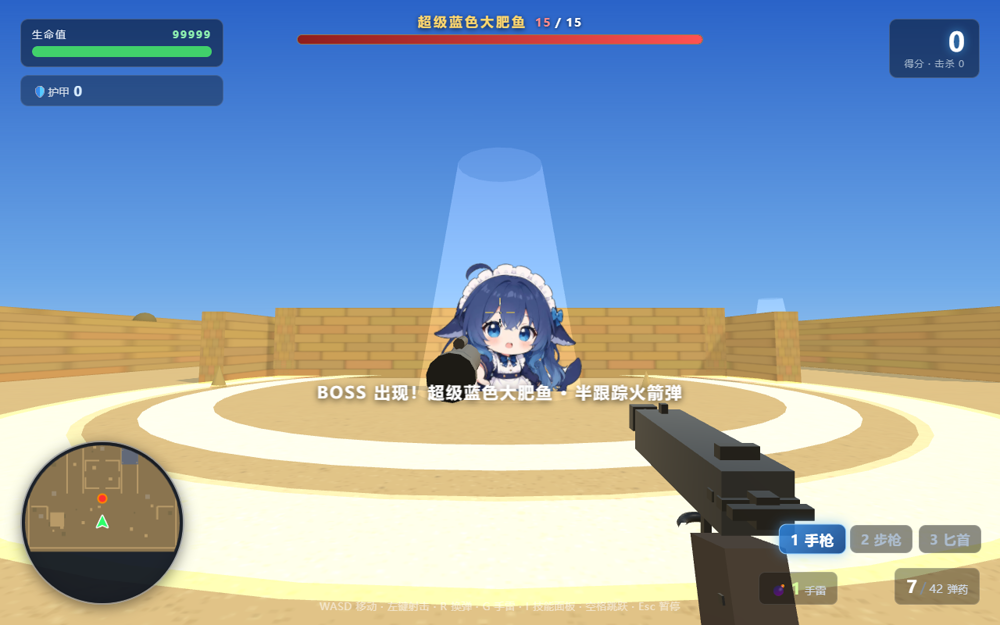

### 4. 自爆鱼 💣「大伊万」（阶段 2 解锁）
怀里抱着一颗**核弹**、头上裹着**白色头巾**的危险分子——核弹上还贴着**核辐射警告标志**。
- 出生时**至少离你 12 米**，随后以 7.2 m/s 高速冲来
- 冲到 **2 米内点燃引信并原地定身**，3 秒后自爆（表面闪着白色光圈）
- 爆炸伤害：**1 米内 100 / 1~5 米 50 / 5 米外免伤**
- 引爆升起**蘑菇云**（火球 + 烟柱 + 云冠 + 冲击环）
- 自爆是它自己的行为，**不计入你的击杀与得分**

> ⚠️ 屏幕边缘**红色脉冲** = 索敌范围内（14 米）存在自爆鱼
> 💡 引信有 3 秒——看到白圈就赶紧拉开距离，或者提前在远处点掉它

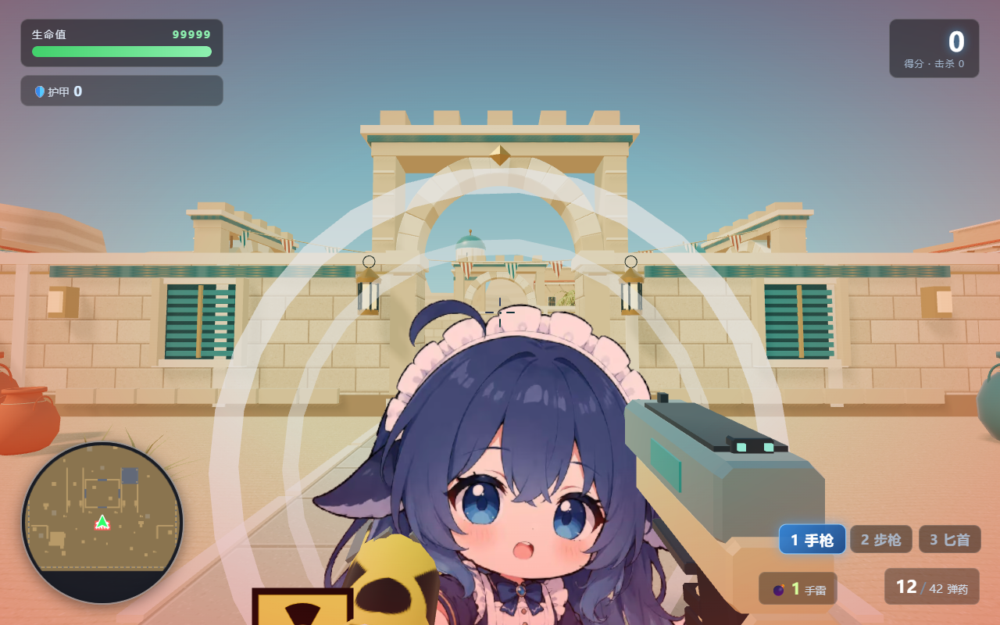

### 5. 护盾鱼 🛡（阶段 3 解锁）
身前举着一面**半透明能量盾**（发光外圈 + 能量核心），从正面射击会被吸收。
- 护盾可承受 **3 发子弹**，命中时迸发格挡火花
- **破盾后**才真正受伤（有碎裂特效与「护盾已击破！」提示）
- 手雷、剑气、爆炸等非子弹伤害不受护盾影响

> 💡 连续三发破盾最快；别让它贴到脸上（它同时持剑近战）

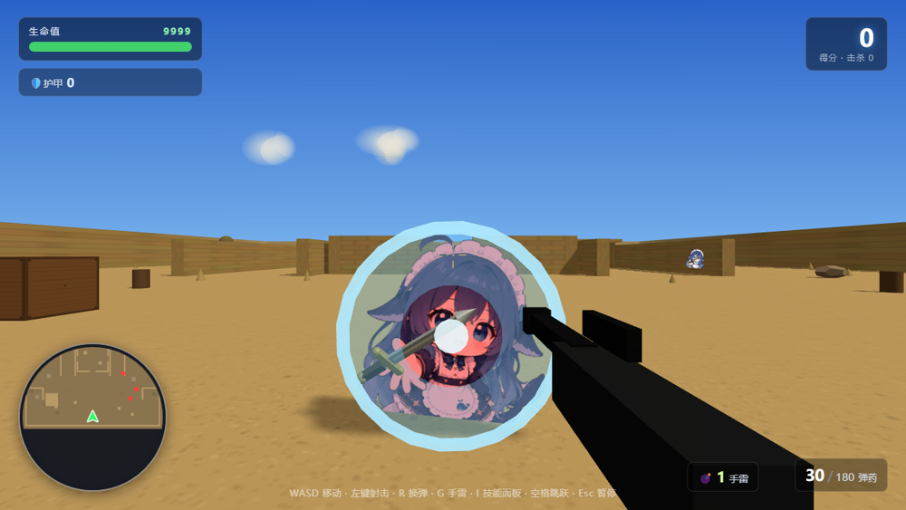

### 6. 治疗鱼 💉（阶段 4 解锁）
戴着**白色护士帽**（红十字）、手里拿着**大针筒**，本身不攻击你。
- 会奔向受伤的同伴，2.4 米内**每 2.4 秒为其回复 1 点生命**（绿色治疗粒子）
- 没有伤员时远离战斗游荡

> 💡 **优先击杀目标**——放着不管，其他敌人会持续回血

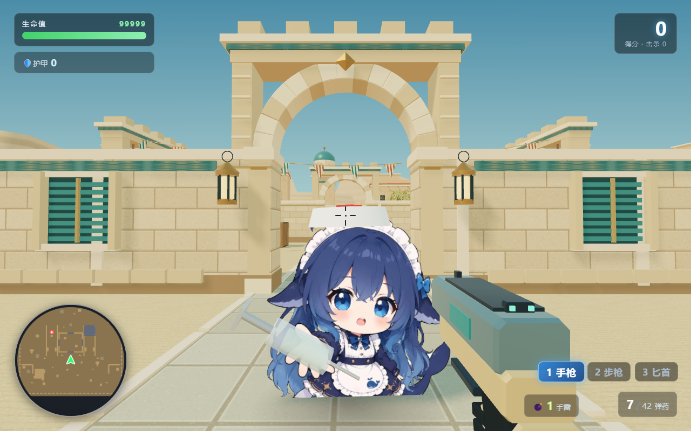

### 7. 分裂鱼 🟢（阶段 5 解锁）
外表与普通鱼相同，但**像史莱姆一样蹦蹦跳跳**移动（跳跃高度 1.7 米、周期 0.8 秒）。
- 持剑近战
- **死亡时分裂成 2 条小鱼**（各 1 点生命）

> 💡 分裂出的小鱼同样计入本波，清波前要一并解决

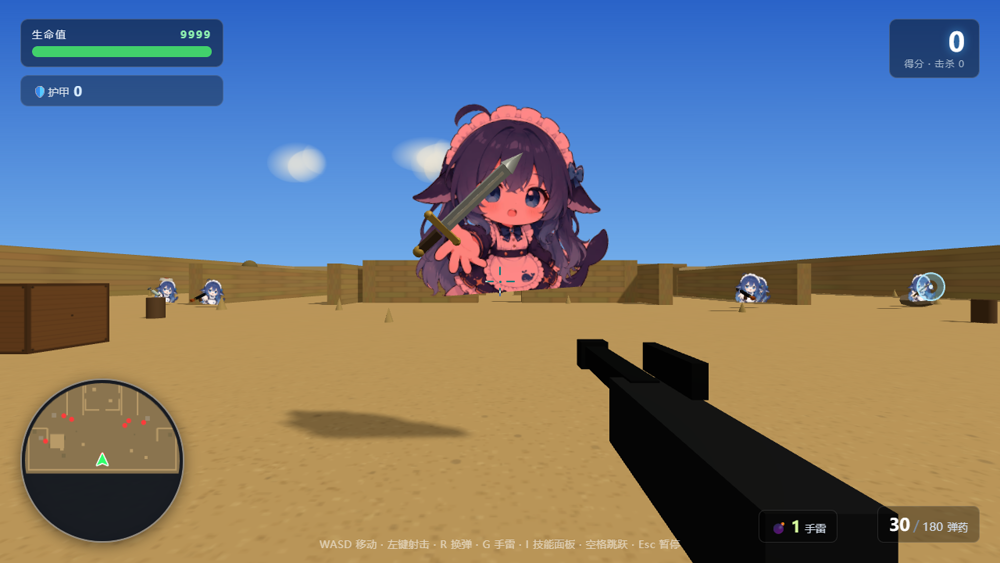

### 8. 蘑菇云特效 💥
自爆鱼引爆时的完整表现：**火球 → 上升烟柱 → 顶部云冠 → 地面冲击环** + 火星粒子。

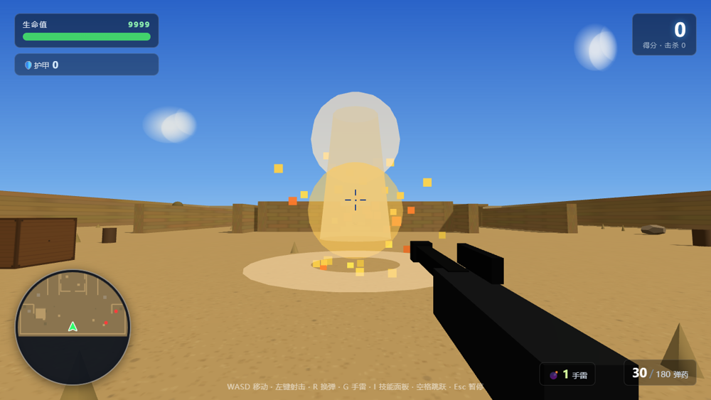

### 9~13. Boss 五变体（按阶段登场 · V0.5.0 新增）

每推进一个阶段，Boss 就会换一种类型 —— **立绘相同，但武器、AI 与打法完全不同**。

| 阶段 | Boss | 武器 | 战斗方式 | 血量系数 |
| --- | --- | --- | --- | --- |
| 1 | **超级蓝色大肥鱼** | 火箭筒 | 半跟踪火箭弹（**炮弹可被击落并空爆**）| ×1.0 |
| 2 | **狂暴冲锋鱼** | 巨剑 | 蓄力后以 15 m/s **高速冲撞**（撞击 30 伤害）| ×1.15 |
| 3 | **召唤祭司鱼** | 发光法杖 | 每 6 秒**召唤 3 条小怪**，并主动后撤保持距离 | ×0.9 |
| 4 | **重炮台鱼** | 三管重炮 | 每 3.2 秒**三连扇形齐射**，几乎不移动 | ×1.25 |
| 5 | **分裂母鱼** | 火箭筒 | **半血暴走**，分裂出 3 条强化小怪 | ×1.2 |

> 💡 **应对思路**：冲锋鱼要在它蓄力时侧移躲避；祭司鱼必须优先贴脸打断召唤；
> 炮台鱼适合找掩体绕着打；分裂母鱼则要在半血前准备好清场手段。

**出场演出**：每次登场都有**三层地面扩散光圈**（红 → 橙 → 黄）+ **中心上升光柱**，配合警报音与台词。

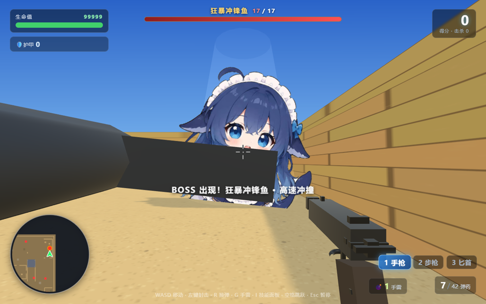

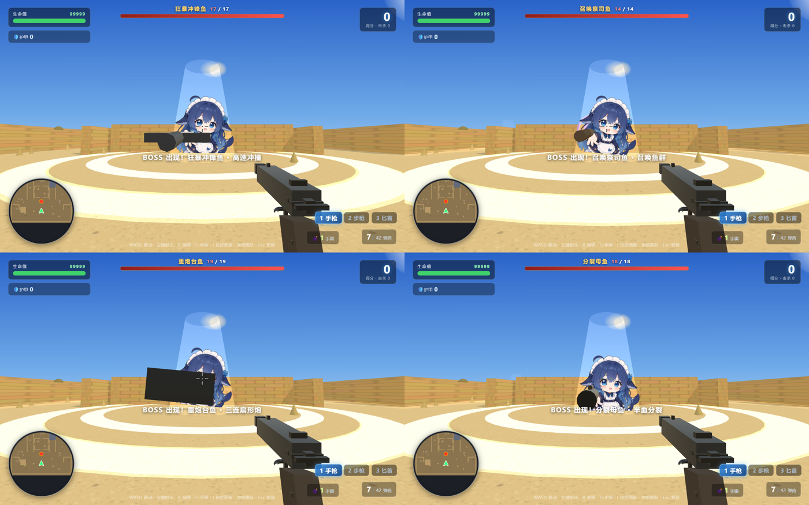

## ✨ 玩法特性

- **三武器系统（V0.5.0 核心）**：数字键 **1 手枪**（点射）/ **2 突击步枪**（全自动）/ **3 匕首**（近战 2.6 米）；
  右下角 HUD 常驻三个武器槽并高亮当前武器；切到匕首时弹药区自动变暗（近战无需弹药）
- **弹药压力与扩容弹夹（V0.5.0 核心）**：开局手枪 7 发 + 42 备弹、步枪 25 发 + 100 备弹，**必须靠拾取补给**；
  击杀特殊敌人（自爆/护盾/治疗/分裂鱼）按 32% 概率掉落扩容弹夹 ——
  手枪 7→10→12→**15**、步枪 25→35→48→60→**弹鼓 120**；
  **不叠加**：只有更高级别才会替换，同级或更低不生效（道具留在地上）；
  **负重**：步枪大扩容弹夹 **-5% 基础移速**、弹鼓 **-10% 当前移速**；
  备弹上限 = 手枪弹夹 × 8 / 步枪弹夹 × 6；**击败 Boss 补满两把枪弹夹并各奖励一个弹夹容量的备弹**
- **匕首近战（V0.5.0）**：左键轻击（2 点）、右键重击（恒为 2 倍），攻击范围 **2.6 米**（略大于近战鱼的 2.1 米，能卡着距离戳），
  伤害随「子弹强化」技能与连杀评级成长；轻击是快速刺出、重击是抬手蓄力后大幅猛劈（动作明显不同）
- **环境主题（V0.5.0）**：每 10 波切换一次 —— 晴日沙漠 → 黄昏 → 沙尘暴 → 血月 → 深夜，
  天空、雾色、光照同步变化，切换时屏幕中央弹出**半屏大字**
- **成就系统（V0.5.0）**：14 项成就（初次猎杀 / 巨兽猎人 / 完美连击 / 百鱼斩 / 千鱼斩 / 深海尽头 /
  二十波老兵 / 十连巨兽 / 铁人 / 完美无瑕 / 一石三鸟 / 登峰造极 / 自爆旁观者 / 无尽征服者），
  解锁时右上角弹出金边卡片；主菜单可查看（未解锁灰化、已解锁金色渐变描边）
- **本地记录（V0.5.0）**：最高分 / 最久存活 / 最高连杀 / 最远波次 / 最高阶段 / 最多 Boss 击破，
  结算界面显示详细统计与「★ 新纪录」，主菜单常驻「历史最佳」
- **设置面板（V0.5.0）**：四路音量分离、鼠标灵敏度、粒子与阴影开关、色盲友好配色，实时生效并自动保存
- **波次与阶段系统（V0.4.0 核心玩法）**：敌人按波次涌来——清空当前波后喘息 4.5 秒再出下一波；
  **每清理 5 波必定出现 Boss**（Boss 存活期间波次暂停，专心 Boss 战）；
  每击破 **4 次** Boss **推进一个阶段**（共 5 阶段），阶段越高每波敌人越多
  （**6 → 8 → 10 → 12 → 14 只**），且**每个阶段解锁一种新敌人**：
  阶段 2 自爆鱼 / 阶段 3 护盾鱼 / 阶段 4 治疗鱼 / 阶段 5 分裂鱼（阶段提升时有专门播报）
- **自爆鱼红屏警告**：只要存活的自爆鱼进入 **14 米索敌范围**，屏幕边缘就会**红色脉冲闪烁**，
  自爆鱼死亡或你脱离范围后才消失
- **沙漠城地图**：约 90×90 米——中央建筑、东西长廊（含 B 洞顶棚）、A/B 开阔广场、绿洲水池、箱堆掩体
- **小地图**（左下角圆形、随视角旋转）：绿箭头=你、红点=敌人、橙圈= Boss、黄方块=弹药箱、红十字=医疗包
- **局内强化（无尽模式）**：击杀 Boss 后弹出 **3 选 1 奖励窗口**（选择前游戏暂停），
  核心五种技能可各升 **8 级**——子弹威力 / 击杀回弹 / 击杀回血 / 击杀掉雷 / 移动速度；
  技能满级后不再出现，**全部满级后再击杀 Boss 即通关无尽模式**（独立成长，死亡/退出不继承）
- **敌人成长**：每击杀 **2 只** Boss——小怪血量 +1（≤10，到顶后攻击 +1，近战 ≤50 / 射手 ≤30）、
  下一只 Boss 血量 +5（≤100）、Boss 炮弹伤害 +2（≤60）、小怪生成速率 +5%
- **护甲道具**：每 10 秒 25% 概率生成（生成时屏幕提示），每拾取一次 = **+1 层护盾**（每层防御力 **2 点**，
  即减免 2 点所受伤害），最高 **15 层 = 30 点减免**，满层后停止生成；小地图显示为青色圆帽淡蓝描边图标
- **Boss 血条数值**：血条上实时显示「当前血量 / 血量上限」，直观看到每局 Boss 上限的成长变化
- **Boss 成长**：每只 Boss 血量下一只 +5（15→20→25…≤100）、炮弹伤害每只 +2（≤60）
- **连杀评级**：连续击杀累计连杀点数（普通鱼 +1 / Boss +5），
  评级 D→C→B→A→S→SS→SSS 逐级飙升；**评级会带来实际增益**——
  **B** 移速 +5% ／ **A** 移速 +5% 伤害 +10% ／ **S** 移速 +8% 伤害 +15% ／
  **SS** 移速 +10% 伤害 +20% ／ **SSS** 移速 +12% 伤害 +25% **且击杀吸血 2%**
  （提升时会在屏幕上播报当前增益）；
  评级字母常驻显示在右侧黄金分割位，
  升级时抖动登场、降级时柔和切换，2 秒无击杀降一级，D 级再 2 秒无击杀才消失；
  字号逐级增大（SSS 为 D 的两倍）、蓝色渐变愈发绚丽
- **补给系统**：每 8~12 秒生成弹药箱或医疗包（+10 生命），走近自动拾取；
  弹药箱拾取后**两把枪各补一个弹夹容量的备弹**；出现概率按备弹比例动态计算：
  **满弹 0% / 剩余 ≥25% 最多 30% / 剩余 <25% 必出 100%**
- **手雷**：开局 1 颗，落地即爆、半径 4 米，5~10 点伤害——小心自伤
- **换弹系统**：手枪 7 发 / 步枪 25 发起（扩容后最高 15 / 120）；弹夹打空自动换弹；备用耗尽提示「弹药耗尽」
- **开发者模式**（秘技 WWSSAADDBABA 切换，5 秒内输入完毕）：生命/上限 99999、仍受伤害、每 5 秒回 100 血；
  屏幕左侧实时 Debug 列表（受到攻击的原始伤害/护盾减免/最终伤害、你对怪物的输出、击败信息），
  消息从下缓慢上移、每条 5 秒后消失；再输一次秘技退出；**技能面板可 -/+ 编辑**（0~8 级实时生效）；
  ⌨️ **开发者快捷键**（小键盘，仅开发者模式）：
  1~4 刷出四种特殊敌人（自爆 / 护盾 / 治疗 / 分裂）；
  **0** 召唤常规 Boss「超级蓝色大肥鱼」+ 晴日沙漠；
  **5 / 6 / 7 / 8** 分别召唤「狂暴冲锋鱼 / 召唤祭司鱼 / 重炮台鱼 / 分裂母鱼」，
  并同步切到对应环境主题（黄昏 / 沙尘暴 / 血月 / 深夜）——方便录制演示视频；
  💀 4 秒内按 KILL 退出开发者模式并自杀；
  🕵️ **作弊被抓**：开发者模式下通关点"回到主菜单"会全屏弹出"抓到你作弊咯！"
  （程序合成的搞怪音乐循环 + 任意键回主菜单，作弊胜利不算数）
- **通关判定**：**核心五项技能全部满级（8 级）** 后，再击杀一只 Boss 即通关无尽模式——
  满级状态在每次技能等级变化时检测并缓存（事件驱动，零帧开销），击杀 Boss 时直接判定
- **3D 平台碰撞**：可跳上箱子、石头，顶棚下通行自由
- **BGM**：开始/选关界面播放「来去曼波」（进入游戏 0.5 秒淡出）；游戏内主背景音乐低音量循环（战败时切换「燃尽的小曲」，点"再来一局"后主 BGM 从头播放）；**Boss 战时切换「战斗的小曲」**——出场淡入、击杀后 0.5 秒匀速淡出；**奖励窗口与技能面板播放「进步的小曲」**，关闭后主 BGM 从暂停进度续播；峰值音量低于射击音效不抢戏
- **敌人 AI**：巡逻 / 发现 / 追击 / 攻击状态机 + 避障寻路（不穿墙、会绕行）；
  特殊行为——自爆鱼直冲并点燃引信（爬行者式 3 秒倒计时，点火后定身）、
  护盾鱼持盾推进、治疗鱼奔向受伤同伴、分裂鱼蹦跳突进且在死亡时分裂
- **近战攻击具象化**：近战肥鱼挥剑时有完整的三段式挥砍动画（预备 → 挥砍 → 收招）与
  **弧形剑气特效**（纯视觉表现，伤害仍按原近战距离判定）

## 🗂️ 文件结构

```
蓝色肥鱼大作战/
├── index.html            游戏入口（双击即玩）
├── 启动游戏.bat          一键启动
├── server.js             可选本地服务器（Node 标准库）
├── js/game.js            游戏逻辑与场景接入（CFG 配置在顶部）
├── js/art.js             Codex 美术模块：材质、场景细节、浅弧模型、资源释放
├── js/combat-art.js      Codex 战斗美术：武器模型、枪口瞄准、弹道与特效池
├── lib/three.min.js      Three.js r159（本地化）
├── assets/
│   ├── sfx/              真实音效（14 个 mp3：枪声 / 敌人台词 / 爆炸 / 失败语音）
│   ├── fish-texture.js   肥鱼贴图（base64 内嵌）
│   ├── 蓝色大肥鱼.png    素材原图
│   ├── bgm.mp3           游戏内默认背景音乐（哈基米音乐合集）
│   ├── menu.mp3          主界面/选关 BGM（来去曼波）
│   ├── boss.mp3          Boss 战斗曲（鼠鼠战歌）
│   ├── progress.mp3      奖励窗口/技能面板 BGM（AW空投小曲）
│   └── gameover.mp3      战败界面 BGM（燃尽的小曲）
├── images/               实机截图
└── tests/
    ├── smoke-test.js     无头冒烟测试（node tests/smoke-test.js，158 项）
    ├── e2e-test.js       HTTP 服务测试（node tests/e2e-test.js）
    ├── browser-art-test.cjs  真实浏览器 / WebGL / 离线启动回归
    ├── browser-combat-test.cjs  武器 / Boss 朝向 / 特效与战斗资源回归
    └── art-results/     美术截图与浏览器验证报告
```

## 🛠️ 技术栈

- **Three.js r159**（UMD 本地化，无构建工具）
- 程序化美术：Canvas 生成砂岩、木箱、风纹沙地、铺装、水面与天空；实例化建筑装饰、棕榈和草丛；敌人沿用原画的浅弧模型
- WebAudio 程序合成音效（脚步/跳跃/换弹/拾取……15+ 种）+ **14 个真实 mp3 音效**
  （枪声、Boss 与敌人台词、爆炸、失败语音；池化播放，支持连发重叠）
- 无任何外部资源依赖（贴图/音乐全部内嵌本地）

## 🧪 测试

```bash
cd 蓝色肥鱼大作战
node tests/smoke-test.js    # 158 项无头冒烟测试
node tests/e2e-test.js      # 服务器端到端测试
```

真实浏览器验证需开发环境安装 Playwright；Windows 默认使用已安装的 Edge。先运行 `node server.js`，再执行 `node tests/browser-art-test.cjs` 和 `node tests/browser-combat-test.cjs`。可通过 `PLAYWRIGHT_MODULE` 指定已有 Playwright 模块位置。这些工具仅用于测试，游戏仍不需要安装依赖。两轮改动、截图和回退说明见 [CODEX_优化与开发建议.md](CODEX_优化与开发建议.md)。

## 📜 开发日志（摘要）

- **v0.5.0（正式版，本轮 · 大规模重构）**——
  **武器与弹药（核心改动）**
  - 新增**突击步枪**（键 2）：全自动 / 25 发弹夹 / 0.72 倍伤害 / 轻微散布，弹药与手枪完全独立
  - 新增**匕首**（键 3）：近战 1 米，左键轻击 2 点、右键重击 4 点（恒为轻击 2 倍）；
    轻击为快速刺出、重击为抬手蓄力后大幅猛劈（动作明显不同）；伤害随子弹强化技能与连杀评级成长
  - 射击模式分离：**手枪改为点射**（按一下打一发），步枪保持全自动
  - **弹药大幅收紧**：手枪 7 发 + 42 备弹、步枪 25 发 + 100 备弹
    （原来是 30/45 弹夹 + 180 备弹，过于充裕，玩家没有拾取补给的动力）
  - **扩容弹夹系统**：击杀特殊敌人（自爆/护盾/治疗/分裂鱼）32% 概率掉落；
    手枪 4 档（7→10→12→15）、步枪 5 档（25→35→48→60→**弹鼓 120**）；
    **不叠加** —— 只有更高级别才会替换，同级或更低不生效且不消耗（道具留在地上）；
    **负重惩罚**：步枪大扩容弹夹 -5% 基础移速、弹鼓 -10% 当前移速
  - **备弹上限**：手枪 = 当前弹夹 × 8、步枪 = 当前弹夹 × 6
  - **Boss 弹药奖励改造**：补满两把枪的弹夹，并各奖励「相当于一个弹夹容量」的备弹
  - HUD 新增**武器栏**：常驻「1 手枪 / 2 步枪 / 3 匕首」三个槽位，当前武器高亮，切到匕首时弹药区变暗

  **Boss 与内容**
  - **五种 Boss 变体**（按阶段登场）：火箭（超级蓝色大肥鱼）/ 冲锋（狂暴冲锋鱼）/
    召唤（召唤祭司鱼）/ 弹幕（重炮台鱼）/ 分裂（分裂母鱼）；
    各自独立武器模型、AI 模式、血量系数与移动速度，血条名称随变体显示
  - **Boss 出场演出**：三层地面扩散光圈（红→橙→黄，依次延迟扩散）+ 中心上升光柱
  - **环境主题系统**：晴日沙漠 / 黄昏 / 沙尘暴 / 血月 / 深夜，**每 10 波切换**；
    天空贴图、雾色与远近、半球光与太阳光同步变化；切换时屏幕中央弹出**半屏大字**（渐显渐隐）
  - **地图随机化**：每局随机散布 5~9 个掩体，全部注册碰撞体与射击遮挡（可跳上、子弹会被挡）

  **成长与平衡**
  - **通关条件重排**（评审指出的「数学上不可达」问题）：阶段门槛 10 → **4 只 Boss**、
    技能上限 10 → **8 级**、每只 Boss 可**强化两次**；
    通关周期从「250 波 / 2-3 小时且实际打不到」变为「约 100 波 / 60-75 分钟」
  - **技能池扩展**为 10 项：核心五项 + 致命打击（暴击 ×2）/ 穿甲弹（穿透）/ 高爆手雷 / 护甲强化 / 杀戮汲取
  - **三处数值失配修复**：治疗鱼改为按生命上限百分比治疗；受伤无敌帧按来源分组
    （近战/远程/爆炸各算各的，不再互相屏蔽）；分裂子鱼不再计分、计连杀或掉落战利品
  - **成就系统**：14 项成就（初次猎杀 / 巨兽猎人 / 完美连击 / 百鱼斩 / 千鱼斩 / 深海尽头 /
    二十波老兵 / 十连巨兽 / 铁人 / 完美无瑕 / 一石三鸟 / 登峰造极 / 自爆旁观者 / 无尽征服者），
    解锁时右上角弹出金边卡片；开发者模式不记录成就
  - **本地最佳记录**：最高分 / 最久存活 / 最高连杀 / 最远波次 / 最高阶段 / 最多 Boss 击破；
    结算界面显示详细统计与「★ 新纪录」提示，主菜单常驻「历史最佳」

  **表现与体验**
  - **真实音效接入**（14 个 mp3）：手枪/步枪枪声（**每发子弹一次**）、Boss 登场台词、
    各类敌人接近台词、自爆与手雷爆炸、失败语音等；
    敌人语音与敌人绑定，敌人死亡立刻掐断（解决「鱼死了还在 biu biu」）
  - **程序化环境反射贴图**（envMap）：解决金属枪械与火箭筒在逆光下退化成黑色剪影的问题
  - **击杀表现升级**：死亡碎裂动画（缩小上浮）+ 金色暴击飘字
  - **设置面板**：四路音量分离 / 鼠标灵敏度 / 粒子特效 / 阴影渲染 / 色盲友好配色，实时生效并自动保存
  - **UI 重做**：主菜单重新布局（开始游戏居中 + 蓝色渐变描边、成就按钮金色描边）、
    暂停界面按钮竖排、成就界面（未解锁灰化 + 已解锁天蓝渐变底与金色描边 + 渐变金字）、
    HUD 武器栏大字体
  - **主菜单不再加载游戏场景**：地图改为首次进入游戏时构建，退回主菜单时真正**卸载**并释放几何
  - **右键彻底屏蔽**：document 级 contextmenu + 鼠标侧键 + 触摸长按菜单 + 拖拽选择，
    为后续更多右键操作铺路
  - **修复**：指针锁定被误判降级且不可逆的 bug（玩家反馈）、枪口火焰未跟随武器枪管长度的问题

  **实机截图**

  

  

  

  

  

  

- **v0.5.3（美术补丁）**——Codex 两轮优化 + 敌人新形象：
  - **场景细化「沙海哨站」**：512px 砂岩墙面（UV 按米展开，长墙不再拉伸）、建筑檐口/墙基/四向拱门/
    青绿百叶窗/窗台/灯具/A-B 导视、风纹沙地与石板道路、弯曲树干与分段棕榈叶、青绿水面与移动水纹、
    木板金属包边掩体、城外塔楼与分层台地、日月与夜空星点；sRGB 输出 + ACES 色调映射
  - **敌人改为 2.5D 浅弧面**：12×12 分段曲面 + 深色背层形成薄立体边缘；呼吸伸缩、摆动、接地软阴影；
    广告牌只跟随水平视角（抬头低头不再整张翻倒）；修正抠图逻辑，白衣/眼白/头饰不再被误删
  - **武器模型全部重做**（新增 `js/combat-art.js`）：手枪倒角套筒与防滑刻槽、步枪机匣护木散热槽导轨、
    匕首中脊双斜面刀刃、分段手雷；Boss 武器统一 `+Z` 朝前、玩家武器保持 `-Z`，三管炮三个独立炮口
  - **战斗特效**：枪焰用交叉面 + 柔边纹理并对齐真实枪口锚点、玩家示踪线连接枪口与命中点、
    圆形柔边粒子 + 命中闪光 + 上升烟尘 + 地面扩散环 + 分层烟柱；特效对象池（112 复用对象 / 360 粒子槽）
  - **代码重构**（新增 `js/art.js`）：材质/纹理/场景细节/敌人曲面/资源释放集中管理；
    `InstancedMesh` 批量绘制、固定种子随机数、按波次回收死亡敌人、回菜单递归释放资源；
    `game.js` 净减少约 290 行
  - **修复墙顶 z-fighting**：删除被檐口覆盖的旧顶面，同高度檐口按矩形并集生成单一顶面，转角不再重叠闪烁
  - **三种敌人新形象**（本次新增）：Boss 换成少女形态、常规鱼的射手形态换成 Q 版服务生、
    常规鱼近战形态与护盾鱼换成 Q 版女仆；自爆/治疗/分裂鱼保持原图。贴图用 rembg 抠图 + 补正方形后
    base64 内嵌进 `assets/enemy-textures.js`（离线可用）
  - **Boss 武器相对位置调整**：`(-1.28, -1.28, 0.47)` / 缩放 1.5 → **`(-2.06, -1.52, 0.34)` / 缩放 1.05**，
    从身体正中移到左侧手边，减少对脸与围裙的遮挡
  - **右键彻底屏蔽加固**：`contextmenu` 提升到 **window 捕获阶段**（子元素 `stopPropagation` 也挡不住），
    新增 `auxclick`（中键/侧键）与右键 `pointerup` 拦截；`pointerdown` 保持放行以免右键重击失效
  - 测试：`smoke-test` 179 项、`e2e-test` 6 项，另有三套 Edge 真实 WebGL 浏览器回归
- **v0.5.2（体验修正）**——
  - **弹药箱出现概率重做**（玩家反馈：开局第一波就刷了三四个，太频繁）：
    原公式是「30% + 紧张度 × 55%」，开局紧张度约 0.31 → 47%，几乎一半补给点都是弹药箱。
    现在改为：**满备弹 0%**（完全不刷）、**剩余 ≥ 25% 时线性 0% ~ 30%**（上限 30%）、
    **剩余 < 25% 时 100% 必出**。
    实测曲线：206/206(100%) → 0%，142/206(69%) → **12.4%**（原来 47%），
    70/206(34%) → 26.4%，40/206(19%) → 100%
  - **开发者模式新增 Boss 召唤快捷键**（方便录演示视频）：
    小键盘 **0** 召唤常规 Boss「超级蓝色大肥鱼」+ 晴日沙漠；
    **5 / 6 / 7 / 8** 分别召唤「狂暴冲锋鱼 / 召唤祭司鱼 / 重炮台鱼 / 分裂母鱼」，
    并同步切到对应环境主题（黄昏 / 沙尘暴 / 血月 / 深夜）；
    按键会先清掉场上旧 Boss 与残留特效，可连续切换录制；
    左下 Debug 日志会记录每次召唤
  - spawnBoss 新增可选参数 forceVariant（不传时仍按阶段自动选择，不影响正式流程）

- **v0.5.1（平衡修正）**——依据 V0.5.0 复评报告修复 5 项 P0 + 4 项 P1：
  - **技能三选一保证至少一张核心牌**：核心只剩 1 项未满时，原来有 50% 概率一张核心都不出，
    通关会被拉长到约 23 只 Boss；现在先固定塞一张核心再抽其余（实测连抽 30 次 0 次缺席）
  - **扩容弹夹掉落 100% 有效**：原档位有 28% 是同级/低级，捡了不生效；现在全部推进一档，
    且该枪已满档时不再掉落它的弹夹
  - **匕首攻击范围 1.0 → 2.6 米**：原来短于近战鱼的 2.1 米，用匕首必定站在敌人攻击圈里、
    杀一只怪要挨 3 次咬；现在可以卡着距离戳
  - **弹药箱重新设计**：拾取后两把枪各补一个弹夹容量的备弹（受上限约束）；
    刷新概率按「两把枪剩余备弹 / 备弹上限总和」动态计算（弹药越紧缺越容易刷，30% ~ 85%）
  - **小怪生命成长放缓**：每只 Boss +1 → 每 **2 只** Boss +1（10 血节点从第 9 只推迟到第 17 只）
  - **5 种环境各挂一条玩法规则**：黄昏补给 -20% / 沙尘暴敌人索敌 -30% /
    血月敌我伤害 +10% / 深夜手雷 +30% 且半径 +1 米
  - **三武器引导**：主菜单操作表与底部提示补「1 / 2 / 3 切换武器」「右键匕首重击」，
    首次进入游戏弹出情境提示（存档标记只提示一次）
  - **新增第 14 项成就**「无尽征服者」（通关解锁）
  - **死配置清理**：移除已被取代的 magSize / startReserve / reloadTime / ammoPack / bossAmmoReward，
    同步修正武器、环境主题、技能描述的注释与 HUD 静态占位（30/180 → 7/42）

- v0.4.0（正式版）——
  · **波次与阶段系统**（无尽模式重构）：准备(2.2s 提示) → 战斗 → 清空 → 喘息(4.5s) → 下一波；
    每击杀 10 次 Boss 升一阶段（共 5 阶段），每阶段每波 +2 敌并解锁一种新敌人
    阶段1: 6 常规 / 阶段2: +2 自爆鱼 / 阶段3: +2 护盾鱼 / 阶段4: +2 治疗鱼 / 阶段5: +2 分裂鱼
  · **Boss 刷新重构**：每清理 5 波必定出现；Boss 存活期间波次暂停
  · **四种新敌人**：
    自爆鱼 —— 怀抱「大伊万」核弹（白色头巾 + 程序化核辐射警告牌），出生距玩家 12 米以上，
      冲到 2 米内点火 → 定身 3 秒（双层白色光圈闪烁）→ 自爆（1m 内 100 / 1-5m 50 / 5m 外免伤）+ 蘑菇云特效，
      自爆不计入玩家击杀与得分
    护盾鱼 —— 身前举能量盾，需 3 发破盾后才能造成伤害
    治疗鱼 —— 护士帽 + 大针筒，优先奔向受伤同伴治疗（2.4 秒 / +1 血）
    分裂鱼 —— 史莱姆式蹦跳移动，死亡分裂成 2 条小鱼
  · **自爆鱼红屏索敌警告**：处于存活自爆鱼 14 米范围内时屏幕边缘红色脉冲
  · **连杀评级增益**：B 移速 +5% → A/S 伤害 +10/15% → SS +20% → SSS +25% 且击杀吸血 2%
  · **开发者快捷键**：小键盘 1/2/3/4 刷出四种特殊敌人（便于测试）
  · **音乐压缩**：立体声 64kbps/32kHz，30.4MB → 13.6MB（游戏总包 33.1MB → 16.3MB）
  · 冒烟测试 147 项全部通过；新增测试接口 startWave / getWave / getStage / spawnEnemy 等
- v0.3.0（正式版）——
  · **摄像机打击反馈系统**（五层手感，参数集中可调）：
    受击抖动（伤害越高抖得越重，v0.3.0 幅度为初版 2 倍）、跳跃摆动（起跳轻晃几下）、
    落地回正（按落地速度下沉 + 前倾回弹后自动归位）、行走晃动（幅度/频率为跳跃的 1/5，
    走动淡入、停下淡出、仅地面生效）、射击后坐（**每发一次**，幅度约走路 1.5 倍，0.09 秒回正不跨发叠加）
  · 近战肥鱼手持小剑：8 个基础建模组合（剑身/剑尖/血槽高光/金色护手 + 双球/皮革剑柄/尾端配重球），
    斜握姿态，挂载位置与射手鱼的枪一致（贴图右手爪爪）
  · 无头测试接口新增 `__debug.getCamFx()`，五层反馈均有数值验证用例
- v0.2.0-rc.5（发布候选 5）——
  · 开发者模式全套：秘技 WWSSAADDBABA 进出（生命/上限 99999、每 5 秒回 100、左侧 Debug 日志）、
    技能面板 -/+ 编辑（0~8 级实时生效）、KILL 自毁秘技、作弊被抓（"抓到你作弊咯！"全屏+搞怪音乐）
  · 通关判定事件驱动化：技能等级变化时检测一次（缓存满级标志，零帧开销）
  · 通关界面"回到主菜单"（修复 victory 后再来一局卡死）；击杀积分提示回归中央飘字
  · 护甲语义修正（每拾取 +1 层 = 2 防御，15 层 = 30 减免满层停刷）
  · 近战成长攻击力漏接修复、Boss 血条数值显示修复（15 / 15 实时展示）
- v0.2：第二代测试版 ——
  · 连杀评级系统（D~SSS，字母常驻/抖动升级/2 秒衰减降级，右侧黄金分割位）
  · 局内强化（Boss 击破 3 选 1 奖励窗口 + I 键技能面板，核心五项各 8 级，全满级通关）
  · 敌人成长曲线（小怪血/攻、Boss 血/炮弹、生成速率随 Boss 击杀增强）+ 护甲道具（15 层封顶）
  · 五曲场景 BGM 体系（菜单/主曲/Boss 战/奖励/战败自动切换，战斗曲淡入淡出）
  · 近战攻击改为三维距离判定（玩家站上高台不再被隔空咬伤）
- v0.1：完整玩法落地 —— 第一人称射击、肥鱼 AI 巡逻/追击/远程射手、Boss 战、换弹/补给/手雷/小地图/3D 平台、BGM

## 📄 License 与版权声明

### 游戏代码

Copyright (c) 2026 **a2244921700-code**

- 本项目由仓库所有者（a2244921700-code）发起并主导测试、验收；
  **全程使用 DeepSeek Harness（AI 编程助手）协助开发**，所有者负责需求定义、试玩反馈与版本验收。
- 游戏代码（`index.html`、`js/`、`lib/`、`server.js` 等）归所有者所有，
  **仅供学习与娱乐交流使用**。

### 角色形象（「蓝色大肥鱼」画像）

- 角色形象素材（`assets/蓝色大肥鱼.png`）版权归原作者（画师）所有，
  原作者主页：**[bilibili @4168597](https://space.bilibili.com/4168597?spm_id_from=333.337.0.0)**
- 本项目将其实例化为游戏中的敌人（普通鱼 / 射手鱼 / Boss），仅作学习与演示用途；
  **未经原作者许可，不得用于商业用途或二次分发。**

### 背景音乐

本项目使用的全部音乐均来源于 B站视频《哈基米の音乐合集》
（[BV1vkLX6EEq1](https://www.bilibili.com/video/BV1vkLX6EEq1)），
**版权不属于该视频作者**——音乐为**社区网友开源**提供，本项目仅从该视频提取音轨用于演示。
特此**声明并感谢**原作者与开源社区 🎵

| 文件 | 使用场景 | 音乐名（声明名称） |
| --- | --- | --- |
| `assets/bgm.mp3` | 游戏内默认背景音乐 | 哈基米音乐合集 |
| `assets/menu.mp3` | 主界面 / 关卡选择 | 来去曼波 |
| `assets/boss.mp3` | Boss 战 | 鼠鼠战歌（原名） |
| `assets/progress.mp3` | 奖励窗口 / 技能查看面板 | AW空投小曲（原名） |
| `assets/gameover.mp3` | 战败界面 | 燃尽的小曲（原名） |

- 各曲目提取片段：来去曼波 4:45~6:48 · 鼠鼠战歌 00:00~02:23 · AW空投小曲 14:32~17:28 · 燃尽的小曲 19:12~21:20
- 音乐为社区开源资源，仅供本项目学习与演示使用；**如需商用，请自行联系开源社区/原作者获取授权**。

### 其他

- Three.js `r159`（MIT License，[threejs.org](https://threejs.org)）；
  项目中的程序化纹理、音效均为代码实时生成，不涉及第三方素材。
